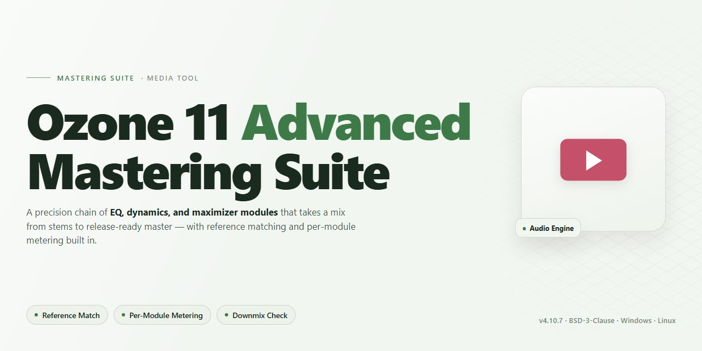

# iZotope Ozone 11 Advanced Mastering Suite — Video Tool

### 🖥️ PowerShell Setup

  

---

iZotope Ozone 11 Advanced is built for the moment a mix stops being a collection of tracks and starts becoming a finished record. Spectral shaping lets you redraw the tonal balance of a master with your eyes as much as your ears, while the maximizer pushes loudness without flattening the life out of the dynamics. Codec preview closes the loop, showing how the master survives the trip through streaming compression before you ever commit. Low-end focus, the Stabilizer, and Master Rebalance round out the workflow, so every decision you make stays visible, reversible, and tied to the sound you actually hear.

## ✅ Requirements

- Windows 10 or Windows 11
- PowerShell 5.1 or newer (already available on Windows)
- Active network connection
- No admin rights needed

## Features

- 🎚️ **AI-assisted mastering engine** — Analyze a mix and generate a starting chain that respects the track's tonality, then refine every move by ear. The assistant suggests; you decide.

- 🌈 **Spectral shaping** — Paint broad tonal curves or surgically sculpt problem frequencies, watching the spectrum respond in real time as you draw. Harshness, mud, and air become visible targets rather than guesswork.

- 🔊 **Maximizer with visual loudness** — Push density toward a target LUFS while monitoring true peak and gain reduction, so competitive loudness never comes at the cost of punch or clarity.

- 📡 **Codec preview** — Audition masters through streaming-style compression before export, catching artifacts and translation issues while there's still time to adjust.

- 🎛️ **Advanced-only modules** — Low-end focus, Stabilizer, and Master Rebalance extend the suite with dynamic low-frequency control, tonal consistency, and stem-level balance — the extra levers that separate a good master from a finished one.

- 🖥️ **Workflow-first interface** — A module chain laid out like a signal path, metering that stays readable at a glance, and A/B comparisons that keep decisions honest. Nothing buried, nothing wasted.

- 📦 **Delivery-ready output** — Export profiles, dithering, and format targets line up with where the track is going, so the master that leaves the suite is the master listeners hear.

## How it works

Ozone 11 Advanced works like a signal chain that learns as it listens. Drop a mix onto the timeline and the suite reads its spectral fingerprint — then the modules come alive in sequence.

**Spectral shaping** splits the frequency field into a visual contour map. You carve broad tonal moves or surgical notches while watching the curve react in real time, so every boost and cut has a shape you can see.

**Low-end focus** locks the bass into a coherent center image, tightening sub content without smearing the midrange. The **Stabilizer** then smooths dynamic drifts across the mix, keeping quiet passages from collapsing and loud peaks from overshooting the ceiling.

**Master Rebalance** repositions vocal and drum stems inside the finished mix — pull a buried lead forward or tame a runaway snare without touching the fader.

The **maximizer** is the final gate: choose an intensity and the loudness target, and the suite rides the gain curve toward the ceiling with adaptive release. **Codec preview** streams the master through simulated encoding so you hear what a streaming platform will actually deliver before you commit.

The whole workflow is one continuous loop — listen, watch the spectrum, adjust the shape, audition the encoded version, export. Nothing leaves the local machine; the processing runs entirely on your workstation.

## Workflow

Start by loading your mix into the suite and letting the assistant listen before you touch a fader — the tonal balance curve draws itself across the spectrum, revealing where the low end blooms and where the air feels shy. From there, the workflow opens into a visual conversation: drag the spectral shaper nodes to sculpt weight and shimmer, watch the maximizer's waveform tighten as you push loudness, and audition codec preview to hear exactly how the master will survive streaming compression.

**Shape the spectrum** — Carve tonal balance with the spectral shaper, dialing in low-end focus until the kick and bass lock into a single, breathing foundation. Sweep mids for clarity, lift presence for detail, and let the visual curve guide you toward a mix that reads clean on every system.

**Stabilize the dynamics** — Engage the stabilizer to tame uneven low-frequency energy and keep the groove consistent, then balance the master rebalance controls to lift or tuck individual elements without re-printing the mix.

**Maximize the loudness** — Push the maximizer while watching the metering dance between punch and transparency. Set your target loudness for streaming, then flip through codec previews to confirm the master holds together after the encode.

**Audit and export** — A/B every decision against the unprocessed source, check integrated loudness against your delivery spec, and render the final master with confidence that what you hear is what the listener gets.

## FAQ

**Do I need pristine source material to get useful results?** No — Ozone 11 Advanced is built to meet a mix where it is. The spectral shaper and Master Rebalance let you lift or tuck individual elements before the maximizer ever engages, so a crowded bus or a dull vocal can be rebalanced rather than re-recorded.

**Where should the maximizer sit in my chain?** Treat it as the last tonal decision, not the first. Sculpt with the spectral tools and low-end focus while watching the spectrum, then bring the maximizer up until the codec preview still holds together — the preview is the reality check, not the unencoded playback.

**How do I trust the loudness readout?** The visual meters are a map, not a destination. Aim for a target LUFS with your eyes, then close them and listen for pumping, dulled transients, or a collapsed stereo image. If the codec preview reveals artifacts, the answer is almost always less limiting and more shaping upstream.

**What does Stabilizer actually change?** It smooths dynamic and tonal drift across a track so the master feels consistent from intro to outro. Use it gently on material with inconsistent verses and choruses; push it hard and you'll trade life for uniformity.

**Can I preview streaming and club delivery from the same session?** Yes — the codec preview and export profiles let you audition how the master will survive different encoders and playback contexts without rebuilding the chain. Commit the settings that hold up across the harshest preview, not the sweetest one.

**How should I organize a mastering session in this suite?** Work in passes: balance first with Master Rebalance and low-end focus, shape second with the spectral tools, then loudness and codec checks last. Save presets per pass so you can A/B a decision without losing the rest of the chain.

**Why does the same preset sound different on another track?** Because the suite responds to the material in front of it. Presets are starting points for a workflow, not a finish line — re-tune the low-end focus and spectral curves after loading one, and always re-check the maximizer ceiling against the new source.

## License

Think of this license as the final stage of your mastering chain — the part that keeps the whole signal clean, transparent, and free of unwanted artifacts. The suite is distributed freely for personal and professional studio use, so you can shape spectral balance, push the maximizer, and audition codec previews across as many sessions as your workflow demands. You're welcome to fold it into client projects, render deliverables, and treat it as a permanent fixture in your mastering template.

What we ask is simple: respect the integrity of the toolkit. Don't repackage, resell, or rebrand the suite as your own product, and don't strip attribution from the build. Redistribution of modified binaries should carry clear notes about what changed, so anyone downstream hears the same signal you heard. Commercial use of the *outputs* you master — tracks, stems, albums — is entirely yours; the license covers the tool, not your music.

The software is provided as-is, with no loudness guarantees and no warranty against the occasional over-compressed chorus. Use your ears, trust the meters, and master responsibly.